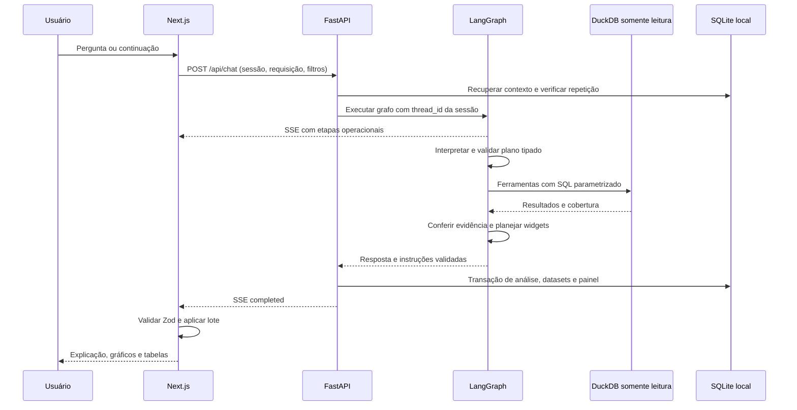

# Arquitetura

## Fronteiras de confiança

O modelo transforma linguagem natural em operações do schema `AnalysisPlan`.
Dimensões, métricas, operações e widgets têm vocabulários fechados. Strings de
filtros são valores parametrizados; não se tornam identificadores SQL. O backend
valida o plano novamente e executa ferramentas registradas pela aplicação.

Os números da explicação vêm dos resultados calculados. Referências de datasets e
colunas são conferidas antes da persistência. O frontend valida o contrato inteiro
e suas referências antes de aplicar qualquer ação. Nenhuma etapa aceita JavaScript,
JSX, código Python, HTML arbitrário ou configurações executáveis de gráficos.

SSE comunica progresso operacional, não raciocínio interno ou prompts. Uma falha
gera um evento público de erro sem salvar um painel parcial. A mesma requisição
com o mesmo conteúdo retorna a resposta persistida; reutilizar o identificador com
outro conteúdo é um conflito.

## Propriedade do estado

- **DuckDB:** snapshots imutáveis dos dados, com schemas raw/staging/analytics.
- **SQLite da aplicação:** sessões, coortes, análises, resultados e layouts.
- **Checkpoint SQLite do LangGraph:** execução e estado do grafo por thread.
- **Next.js:** estado visual transitório e componentes de renderização.

Cada sessão mantém o snapshot escolhido. Atualizar a fonte não muda análises
anteriores; uma investigação nova usa o snapshot ativo. “Desses” significa as
chaves da coorte retornada, não uma repetição do ranking global. Fixar preserva a
configuração e o dataset imutável do widget.

## Ingestão e publicação

O comando de ingestão tem permissão para baixar e escrever arquivos. As ferramentas
do agente operam somente sobre o snapshot publicado, com leitores DuckDB sem acesso
externo. Um arquivo DuckDB em construção nunca é o arquivo consultado pela API.

O catálogo identifica os recursos; o manifesto registra hashes e aliases de
concessões. Recursos sucessores podem corrigir históricos, portanto a seleção da
família ocorre antes da consolidação. A publicação troca o ponteiro ativo apenas
depois de construir e validar o novo banco. Arquivos raw continuam disponíveis para
rastrear cada ocorrência e cada exclusão.

## Geografia e semântica

Os registros contêm rodovia, UF e km, não coordenadas. O mapa estadual usa polígonos
oficiais do IBGE e não sugere a localização exata dos acidentes. Faixas de 10 km são
agrupamentos analíticos explicitamente rotulados.

Cobertura significa presença observada de registros, não certificação de reporte
completo. Contagens ausentes permanecem desconhecidas; frequência de acidentes não
é uma taxa de risco ajustada pelo tráfego.

## Referências técnicas

- [LangGraph: StateGraph](https://reference.langchain.com/python/langgraph/graph/state/StateGraph)
- [LangGraph: streaming](https://docs.langchain.com/oss/python/langgraph/streaming)
- [LangGraph: AsyncSqliteSaver](https://reference.langchain.com/python/langgraph.checkpoint.sqlite/aio/AsyncSqliteSaver)
- [LangChain: saída estruturada](https://docs.langchain.com/oss/python/langchain/models#structured-output)
- [OpenAI: Structured Outputs](https://developers.openai.com/api/docs/guides/structured-outputs)
- [DuckDB: concorrência](https://duckdb.org/docs/stable/connect/concurrency.html)
